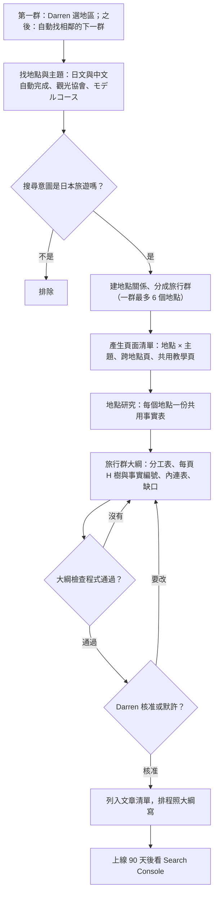

# 選題流程

2026-10-16 Darren 確認改成「旅行群」流程：先把常一起去的地點分成一群，整群一起規劃、一起出大綱，一群核准一次。2026-10-17 起，下一群由 [找下一群](next-group.md) 自動選出，大綱採默許核准。舊流程（逐頁依 Ahrefs 搜尋量決定、逐頁核准）作廢。舊版流程圖網頁 <https://claude.ai/artifact/WdMc73vfHfrZuZURnUZPhj> 已過時，以本文件為準。

## 1. 選地區

地區的第一群由 Darren 選；之後在目前這群剩下的篇數大約夠寫 7 天（7 × 每天上限篇數）時，照 [找下一群](next-group.md) 自動找相鄰的下一群，不跳區。以下是選第一個地區時的參考：

- 建議選四到六個月後是旺季的地區。例如十月開始寫北海道，趕上十二月到二月的雪季與二月的札幌雪祭。
- 地區順序不照地圖。北海道之後建議接東北，九州、四國放後面；台灣旅客去四國最少，排最後。
- 參考依據：觀光廳「宿泊旅行統計調查」中台灣旅客的都道府縣分布、Google 趨勢的季節曲線。

## 2. 找地點與主題

不用 Ahrefs（2026-10-16 Darren 決定）。四個來源：

1. **日文 Google 自動完成**：找地點，以及日本人怎麼稱呼、常和哪些地點一起搜。用法見 [關鍵字來源](keyword-sources.md)。
2. **觀光協會與市町村的地點清單**、日本政府觀光局。
3. **モデルコース**：觀光協會、交通公司、JR 的建議行程，看哪些地點被排在同一天或同一趟。
4. **中文 Google 自動完成**：找台灣讀者對這個地點在意什麼主題、用什麼字，例如「禮文島船票」「稚內船班」。

每個地點記下繁中名、日文名（日文漢字與繁中常不同：稚内、礼文島、釧路湿原）、所屬地區、對外出入口（機場、車站、港口）。

### 篩意圖：是不是日本旅遊

實際看搜尋結果頁，排除下列情況：

- 台灣同名地名：岡山、松山、中山、板橋、豐原；「川湯溫泉」的流量其實是台北北投的「川湯春天」。
- 無關意圖：「利尻昆布」多半是染髮劑品牌；「余市」主要是威士忌；「破冰船」混有新聞與其他國家。
- 意圖混合時，只保留旅遊部分，並在規格裡寫明。

## 3. 建地點關係、分成旅行群

地點之間的關係填在規格的 `place` 欄位（所屬地區、鄰近地點、出入口、適合月份）。判斷兩個地點是不是同一群，看四個訊號，符合兩個以上就算同一群：

- 共用出入口：例如利尻、禮文都從稚內港上船。
- 共用交通：同一條渡輪、同一條巴士路線。
- 日文自動完成互相出現：搜「礼文島」會跳出「利尻 礼文」。
- モデルコース排在一起。

規則：

- 一群最多 6 個地點。超過時依出入口拆成兩群。
- 大城市不當一個地點，改用「區」當地點，例如札幌拆成大通、薄野、定山溪。
- 一個地點只屬於一群。兩群都會經過的出入口城市（例如稚內），歸到它自己最常被當目的地的那群，另一群在跨地點頁或交通頁連過去。

範例：稚內、宗谷岬、利尻島、禮文島是一群。

### 跨群的關聯

群只是規劃與核准的單位，地點之間的關係不受群限制。例如小樽在札幌群，余市在積丹半島群，但余市要從小樽轉車，旅客也常把小樽和余市排在同一天。跨群關聯不需要 Darren 另外決定，照下面的規則處理（2026-10-17 Claude Code 依 Darren「跨群的事不一定要我做」設計，Darren 可推翻）：

1. **關係記在地點，不記在群**。全站地點登錄 `content-planning/places.json` 記每個地點的所屬群、出入口、鄰近地點與上線狀態；鄰近地點與出入口可以指向別群的地點，也可以指向還沒規劃的地點。
2. **規劃新群時先讀全站紀錄**。讀 `places.json` 與全站分工表 `content-planning/ownership.json`，找出新群和已規劃、已上線地點的關聯。判斷訊號和分群一樣（共用出入口、共用交通、日文自動完成互相出現、モデルコース排在一起），只是沒達到分成同一群的程度。
3. **分工規則跨群照用**：
   - 從出入口到某地，一律寫在該地的交通頁。小樽到余市的交通寫在余市交通頁，即使兩地不同群。
   - 兩群的地點一起排（小樽和余市一日遊），寫成跨地點頁，歸後規劃的那群。
   - **先上線的負責**：已經上線的頁面負責的事，後面的群不搶、不重寫，只連過去。兩群都還沒上線時，先核准的群負責。
4. **新群的大綱照常列出跨群關聯**：分工表標明哪些事由別群的頁面負責，內連表列出連到別群的連結，另列「回頭補」清單：別群已上線的頁面要加哪些連結。這些只是大綱的一部分，跟著整群一起核准，不是另外的決定。
5. **舊群頁面的修改由 routine 依規則自動做**，不用 Darren 核准，結果記進每週摘要：
   - **地點欄位**：新地點上線時，把它加進相關舊地點的鄰近地點或出入口。Sanity 的地點關聯只能指向已建立的地點，所以要等新地點上線後才補；這只改欄位，不改正文。
   - **結尾的相關連結**：在舊頁結尾的「同一地點其他主題頁、常一起排的地點」清單加一行，寫新頁名稱與一句用途。這行不寫新的事實（不含數字與條件）；要寫事實就只能引用舊頁已有的事實編號。加完跑格式檢查與網站檢查，不重跑整篇驗收。
   - **舊頁的事實錯了或缺了**：例如舊頁寫「小樽沒有直達余市的巴士」，新群研究發現有。這走一般的事實修正流程：重新查證、修正、驗收，由 routine 處理。
   - 要改舊頁的分工或重寫段落時，不自動做。依「先上線的負責」，這種情況應該不會發生；真的遇到時，停放並記進每週摘要。

## 4. 產生頁面清單

1. **地點 × 主題**：每個地點對固定主題各開一頁，預設每個組合都成頁，搜尋量只決定先後（Darren 2026-10-16 決定）：
   - 交通（`transport`）：從出入口怎麼到、當地怎麼移動、沒車怎麼去各處。
   - 住宿（`stay`）。
   - 步道與登山（`hiking`）。
   - 景點（`sight`）。
   - 美食（`food`）。
   - 祭典與花火（`festival`）。
   - 天氣與季節（`weather`）：每月氣溫、穿著，和步道頁、景點頁分清楚。
2. **地點條目**（`place-entry`）：地點的主頁，值不值得去、住幾晚、幾月去，每個主題兩三句並連過去。
3. **跨地點頁**（`cross-place-page`）：同一群兩地以上一起才講得清楚的事，例如「利尻島與禮文島怎麼一起排」。
4. **共用教學頁**（`shared-guide`）：各地相同的操作，例如 Heartland Ferry 網路訂票。全站已經有的就直接連，不重開。

**不做**：這個組合完全查不到可用來源，例如沒有任何官方列出的住宿。寫進規格的 `decision: remove` 並說明。

**資料太少就併進主頁**（2026-10-17 Darren 決定）：太多很短的頁面，可能被 Google 當成大量製造的低價值內容。地點研究做完後，某個主題符合下面任一條，就不單獨成頁，寫成地點主頁裡的一節，規格填 `decision: merge` 並寫明併入 `<地點>` 主頁：

- 只屬於這個主題、這個地點的事實少於 15 筆（共用教學頁或別頁負責的事實不算）。
- 預估正文不到 800 字。

門檻是暫定值，稚內群寫完後依實際篇幅與 Search Console 調整。之後資料變多（例如新開了店、查到更多官方資料），再從主頁拆成獨立一頁。

**分工規則**決定每件事放哪一頁，見寫作 Skill 的 [頁型](../../japan-travel-answer-first/references/page-types.md)：只牽涉一地寫在該地主題頁；從出入口到該地寫在交通頁；同群兩地以上寫在跨地點頁；各地相同的操作寫在共用教學頁。稚內群的三地渡輪例外，另成 `/places/wakkanai/ferry/`（2026-10-18 隨 26 頁核准），各地交通頁只摘要並連過去。

## 5. 地點研究

每個地點做一份共用事實表，整群的頁面都用同一份事實編號。來源依寫作 Skill 的內容分級：交通與規則只用經營者官方；店家用官網與官方社群，平台交叉核對；人氣附查核日期。

共用事實表讓同一個事實在主頁和主題頁說法一致；班表換季時，也能一次找出所有用到這筆事實的頁面。

每個地點另外做 [景點比對與體驗研究](experience-research.md)（2026-10-18 Darren 決定）：用官方景點清單比對，確認每個景點都有歸屬；從 YouTube、部落格與競品行程頁找體驗與文化切入點，查證後才寫。

## 6. 旅行群大綱

整群一份大綱，給 Darren 看一次。內容：

1. **分工表**：每一件事的負責頁與只摘要的頁。
2. **每頁的 H1／H2／H3**：每個標題附它用到的事實編號，以及對應的 `mustAnswer`。**標題照旅客動線排，不照資料類別切**（Darren 2026-10-18 決定）：
   - 交通頁：去程（怎麼到）→ 抵達後的第一件事（下船、下飛機、出車站）→ 當地怎麼移動（最多人用的方式先）→ 特殊情況（冬天、停駛）→ 回程。
   - 要訂票的頁（渡輪、觀光巴士）：先決定哪季、哪班 → 怎麼訂 → 搭乘當天從出門到上車 → 車上或船上 → 費用 → 出狀況怎麼辦 → 站內設施與位置。
   - H3 用讀者的動作或問題命名（「從稚內去利尻島鴛泊港」「帶小孩搭船怎麼買票？」）。不設「常見問題」H2，問題放進它所屬的那一節。
   - 理由：照類別切（航線、票價、訂票、停航、車站、船上）每節都得自成一體，同一件事要重講，每段也會寫成「主題句→規則→例外→建議」的小論證，讀起來像報告。渡輪頁並排比較，兩位評審的「架構感」從 75～78 降到 45，見 `content-experiments/polish-test-2026-10-18/ai-tone-study.md` 第7輪。
3. **內連表**：從哪頁、哪一節、連到哪頁、這句連結的用途。
4. **缺口**：還要補研究的事實；查不到時這頁要怎麼寫。
5. **寫作順序**：被最多頁連到的頁先寫（通常是交通頁與共用教學頁），地點條目最後寫，摘要才能對上已寫好的主題頁。
6. **景點比對、體驗線索與媒體計畫**：`spotCoverage[]`、`experienceLeads[]`、`mediaPlan[]`，見 [景點比對與體驗研究](experience-research.md)。

大綱檢查程式要擋：

- 同一件事有兩個負責頁，或「只摘要」指到沒負責這件事的頁。
- 主題頁沒有連回主頁、主頁沒有連到每個主題頁。
- H1 沒有主要查詢、用冒號；正文 H2 沒帶地名；次要查詢不在任何 H2／H3。
- 標題引用的事實編號不在事實表。
- 規格的 `mustAnswer` 沒有對應到任何標題。

範例：`content-planning/hokkaido/rebun-outline-draft.md`。

## 7. 核准整群

大綱摘要寫進 Google Sheet「日本站規劃總表」，並在 Darren 的 Google 日曆提醒。Darren 可以核准、刪頁或要求修改；到了自動核准日沒有反對就算核准（例外情況不默許），細節見 [找下一群](next-group.md) 第 5 步。核准後，整群的頁面一起寫進 `content-automation/article-queue.json`。Darren 的意見寫進規則庫（分工規則、主題範本、標題規範、語氣），不只改這一群。

## 8. 上線 90 天後

- 在 Search Console 看每頁被哪些詞搜到，補進該頁的必答問題或調整標題。
- 整頁幾乎沒有曝光，檢討題目、標題或是否被大站壓住。
- 住宿相關每年重查官網一次；班表每年 4 月底與 10 月換季時重查交通頁。

## 試點範例：稚內、利尻、禮文（2026-10-16 查）

當時用 Ahrefs 查過（之後不再使用），數字只當參考：

| 地點 | 地名月搜尋量 | 主要面向 |
|---|---|---|
| 稚內 | 1,100 | 天氣 250、景點 200、自由行 50、住宿 30、交通 20 |
| 宗谷岬 | 200 | 搜尋結果和稚內不重疊，獨立成地點 |
| 利尻島 | 600（另有「利尻」300，意圖混染髮劑） | 交通 30、天氣 30、自由行 20 |
| 禮文島 | 400 | 住宿 20、交通 10、船票 0 |

三地的前十名有三個網址重複出現，Google 把它們視為同一趟旅程，這也是它們算同一群的證據。
