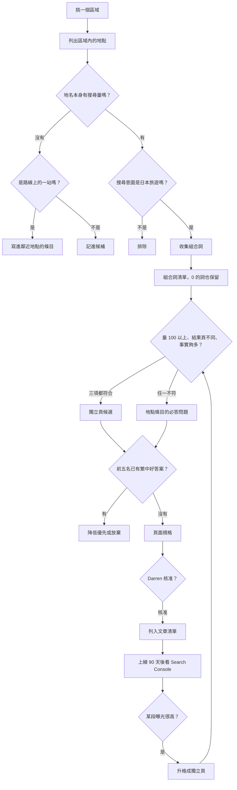

# 選題流程

流程圖的網頁版：<https://claude.ai/artifact/WdMc73vfHfrZuZURnUZPhj>（只有 Darren 能開啟）。以下文字版是規則本身，兩者不一致時以本文件為準。

## 1. 挑區域

- 選四到六個月後是旺季的區域。例如十月開始寫北海道，趕上十二月到二月的雪季與二月的札幌雪祭。
- 區域順序不照地圖。北海道之後建議接東北，九州、四國放後面；台灣旅客去四國最少，排最後。
- 參考依據：觀光廳「宿泊旅行統計調查」中台灣旅客的都道府縣分布、Google 趨勢的季節曲線。

## 2. 列地點

- 來源：都道府縣與市町村觀光協會的地區介紹、日本政府觀光局繁中站、地圖上的鐵路與渡輪路線。
- 每個地點記下繁中名、日文名（日文漢字與繁中常不同：稚内、礼文島、釧路湿原）、所屬地區、對外出入口（機場、車站、港口）。

## 3. 篩地點：地名本身有沒有量

- 用 Ahrefs 台灣資料庫查地名本身，寫法用無空格形式，並查常見變體（「利尻島」「利尻」「北海道利尻島」）。
- 有量就進下一步。沒有量但是路線上的一站，例如轉車的小鎮，就在鄰近條目寫成一段。其他記進候補，之後依 Search Console 或發現清單再評估。
- Ahrefs 未連接時，用 Google 自動完成與搜尋結果頁判斷是否有人在找，`provider` 記為 `SERP observation`。

## 4. 篩意圖：是不是日本旅遊

實際看前十名搜尋結果，排除下列情況：

- 台灣同名地名：岡山、松山、中山、板橋、豐原；「川湯溫泉」的流量其實是台北北投的「川湯春天」。
- 無關意圖：「利尻昆布」多半是染髮劑品牌；「余市」主要是威士忌；「破冰船」混有新聞與其他國家。
- 意圖混合時，只保留旅遊部分能接住的量，並在規格裡寫明。

## 5. 收集組合詞

對每個地點，從四個來源收集「地點×面向」的組合：

1. **Ahrefs 實際組合**：查含地名的所有詞，抓到想不到的面向與陷阱。
2. **固定面向清單**：交通、住宿、天氣、美食、自由行、一日遊、景點、渡輪或巴士、登山、祭典、花火、神社、溫泉、季節（花季、流冰、雪）。
3. **Google 自動完成與相關問題**：搜尋結果頁的「相關問題」與自動完成建議，例如「稚內幾月下雪」「禮文島船票」「稚內船班」。這些在 Ahrefs 常是 0，但確實有人在打。
4. **發現清單**：研究時從日文官方資料找到的祭典、花火、特色料理、步道，見 [發現清單](discovery-log.md)。

全部整理成一張組合詞清單，0 的詞也保留，標明來源。

## 6. 逐一判斷：獨立頁還是條目段落

一個組合要單獨成頁，三項都要符合：

1. 搜尋量 100 以上（無空格寫法）。門檻為暫定值，跑完北海道第一輪後依實際排名調整。
2. 搜尋結果頁和地名本身不同，代表 Google 把它當另一個問題。比對前十名的共同網址，共同網址過半就視為同一個問題。
3. 有足夠的獨立事實撐滿一頁。例如住宿頁要有數間旅館的房型、含餐、訂房管道可以比較。

任一不符合，就列進地點條目的 `mustAnswer`。旅館名稱、船班、票價這類 0 量的具體問題特別要保留，例如「稚內 Dormy Inn」代表讀者已在比較旅館，離訂房只差一步。

## 7. 看前五名

- 前五名已經有完整、近期、繁中的好答案，就降低優先或放棄。
- 前五名多是維基百科、旅行團行程頁、只列景點的清單文，或 DR 很低的小站，代表有位置可搶。稚內的前十名有 DR 18 與 DR 33 的小站，就是這種情況。

## 8. 寫頁面規格

格式見 [頁面規格](page-spec.md)。整理成一份清單交給 Darren，清單要能一眼看出：頁型、主要查詢、搜尋量證據、競爭情況、必答問題數、為什麼值得寫。

## 9. 上線 90 天後

- 在 Search Console 看每頁被哪些詞搜到。條目裡某一段的曝光明顯高，就回到第 6 步評估升格。
- 整頁幾乎沒有曝光，檢討題目、標題或是否被大站壓住。
- 其他頁面維持現狀，住宿相關每年重查官網一次。

## 試點範例：稚內、利尻、禮文（2026-10-16 查）

| 地點 | 地名月搜尋量 | 主要面向 | 處理 |
|---|---|---|---|
| 稚內 | 1,100 | 天氣 250、自由行 50、住宿 30、交通 20 | 地點條目；天氣先寫成段落 |
| 利尻島 | 600（另有「利尻」300，意圖混染髮劑） | 交通 30、天氣 30、自由行 20 | 地點條目 |
| 禮文島 | 400 | 住宿 20、交通 10、船票 0 | 地點條目 |
| 跳島渡輪 | 各組合 0～10 | 稚內到利尻島 10、稚內船班 0 | 三個條目共用的交通頁候選 |

三地的前十名有三個網址重複出現，Google 把它們視為同一趟旅程，條目之間要用鄰近地點與出入口欄位互相連結。
