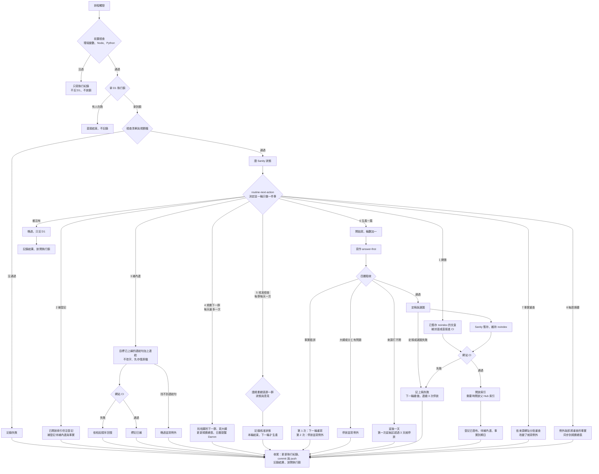

# 自動化 routine 架構（2026-10-17）

本站 routine 的整體設計。文章品質（寫作與驗收怎麼做）是另一條流程，本文件只管「routine 怎麼跑、資料放哪、每一步由哪支程式負責」。主流程沿用好材誌自動發布（固定清單、Sanity 狀態判斷進度、一輪一篇、noindex 暫存、CI 後開放索引），再加上本站需要的旅行群、默許核准、停放、補內連與事實重查。每一步的實際指令在 `.agents/skills/japan-travel-auto-publisher/SKILL.md`。

## 流程圖

可以直接在瀏覽器打開的版本：`content-automation/routine-flow.html`（需要網路載入 Mermaid）。

## 資料放哪

| 位置 | 內容 | 誰會改 |
|---|---|---|
| Git `content-planning/` | 規格、群大綱、全站地點清單、全站分工表、地點事實表（原文證據） | 規劃 session；routine 只在「規劃下一群」時，且檢查通過 |
| Git `content-automation/article-queue.json` | 已規劃的文章清單、旅行群與寫作順序、自動核准日 | 同上 |
| Git `content-production/<article-id>/` | 每篇的文章封包 | routine |
| Sanity（公開） | 文章、Hub、作者；文章是否已暫存、已開放索引 | routine（透過 studio/scripts） |
| D1（私有） | 執行鎖、每輪紀錄、文章生產狀態與停放、旅行群核准狀態、事實查核狀態、待補內連、跨群回補、例外 | routine 與規劃 session（透過 scripts/ops-*.mjs） |
| Google Sheet「日本站規劃總表」 | 給 Darren 看與回覆意見的窗口 | routine 寫入；Darren 寫意見 |

routine 每次都是全新下載的雲端 session，進度只看 Sanity 與 D1，不看 Git 裡有沒有檔案。

## 一輪做什麼

每輪先拿 D1 執行鎖、記錄開始，再由 `scripts/routine-next-action.mjs` 依固定優先順序決定**只做一件事**，做完記錄結果、放鎖：

1. **續做**：有 `staged_noindex`（已暫存未開放索引）的文章，先把它做完。
2. **補登記**：文章已經在 Sanity 開放索引，但上一輪在登記待補內連與事實前中斷，補登記。
3. **補內連**：來源與目標都已上線的待補內連，補上連結（只加連結，不改字）；補不上的略過並寫例外。
4. **規劃下一群**：已核准、還沒寫的篇數約剩 7 天的量（7 × 每天上限），而且沒有還沒核准的群時，執行選題 Skill 的找下一群流程。每天最多試一次。
5. **核准檢查**：清單裡下一篇所屬的群還沒核准時，讀規劃總表判斷是否核准。每群每天讀一次；這一輪只記錄結果，下一輪才生產。今天讀過還沒核准的群，它的文章先跳過。
6. **生產一篇**：清單裡下一篇可以開始的文章。條件：所屬旅行群已核准、文章不是停放中、不在延後期間、當日額度還有剩。
7. **事實重查**：有到期的事實時，依來源網址分批重查。
8. **每週摘要**：每週一次把例外與即將重查的事實同步到規劃總表。
9. 都沒有就略過，只記 D1。

順序的理由：先收尾已經做一半的、補上漏掉的登記，再處理不改字、風險最低的內連；規劃排在生產前面，才能在這一群寫完前就準備好下一群（每天最多一次，不會搶走太多額度）；維護放最後。

## 文章的生命週期

狀態記在 D1 `article_status`；發布與索引狀態以 Sanity 為準。

| 狀態 | 意思 | 下一步 |
|---|---|---|
| `queued` | 在清單裡，還沒開始 | 輪到時開始寫 |
| `writing` | 這一輪正在寫；`attempts` 加一 | 驗收通過 → `accepted`；失敗見下 |
| `accepted` | 驗收通過，準備定稿與上稿 | 上稿暫存 → Sanity `staged_noindex` → CI → 開放索引 |
| `published` | Sanity 已開放索引 | 登記待補內連與事實 |
| `deferred` | 來源網站打不開，`defer_until` 前不挑它 | 到期再試；從第一次延後算起超過 3 天就停放 |
| `parked` | 停放，不再自動挑中 | 寫一筆例外到規劃總表，等人處理 |

失敗的處理：

- **事實錯誤**（驗收判退，原因是事實或條件）：可以再寫一次；同一篇最多 2 次，第 2 次還是判退就停放（`park_kind=facts`）。
- **架構問題**（缺事實、分工不對、大綱和實際資料對不上）：直接停放（`park_kind=needs-outline`），不自己改分工。
- **來源打不開**：延後一天（`deferred`），換下一篇。
- **上稿失敗**（定稿、選圖、Sanity 暫存或 CI 失敗）：狀態不變、不開放索引，下一輪從「續做」接手；連續 3 次就停放。
- 停放或延後的文章不會擋住清單，routine 直接挑下一篇。

## 旅行群與默許核准

- 清單的 `travelGroups[]` 記每一群的成員批次、寫作順序（被最多頁連到的先寫，地點主頁最後）與自動核准日。一群可以跨多個 Hub（每個地點一個 Hub，加上共用教學頁的 Hub）。
- 核准狀態記在 D1 `group_status`：`awaiting-approval` → `approved`（`approved_by` 是 `darren` 或 `default`）；Darren 在規劃總表寫意見或把狀態改成「要改」「暫停」時變成 `changes-requested` 或 `paused`。狀態欄是「已核准」時，意見只當備註。
- 還沒核准的群（包含要改、暫停）每天讀一次規劃總表，Darren 改完就會接著跑。群一旦核准就維持核准；之後要停，請在規劃總表把狀態改成「暫停」並開 session 處理。
- 還沒核准的群存在時，不會規劃再下一群（大綱最多往前一份）。

## 程式分工

| 程式 | 做什麼 | 狀態 |
|---|---|---|
| `scripts/manage-auto-publisher-lock.mjs` | D1 執行鎖 | 已完成 |
| `scripts/ops-run.mjs` | 每輪開始與結束紀錄 | 已完成 |
| `scripts/ops-sheet-sync.mjs` | 例外與到期事實同步到規劃總表 | 已完成 |
| `scripts/article-automation-policy.mjs` | 清單規則、旅行群、生產順序；自動化還不支援子 Hub | 已完成 |
| `scripts/ops-article.mjs` | 文章生產狀態轉換（開始、通過、停放、延後、上稿失敗、發布） | 已完成 |
| `scripts/ops-group.mjs` | 旅行群核准狀態（讀規劃總表的回覆後判斷） | 已完成 |
| `scripts/routine-next-action.mjs` | 決定這一輪做哪一件事 | 已完成 |
| `studio/scripts/inspect-article-queue.mjs` | Sanity 狀態；生產順序已依旅行群 | 已完成 |
| `studio/scripts/publish-*.mjs`、`release-indexable-article.mjs`、`prepare-parent-hub.mjs` | 上稿、封面、開放索引、建 Hub | 已有 |
| `scripts/finalize-release.mjs` | 定稿：驗收通過的封包轉成 Sanity 正文與帶預先授權的 manifest | 已完成 |
| `scripts/ops-links.mjs`、`scripts/link-backfill.mjs`、`studio/scripts/apply-pending-link.mjs` | 待補內連登記、補連結（只加連結標記、可回復）、略過 | 已完成 |
| `scripts/ops-facts.mjs` | 地點事實表同步到 D1、到期清單、重查紀錄 | 已完成 |
| `scripts/planning-formats.mjs`、`scripts/check-planning.mjs` | 全站地點清單、分工表、地點事實表、群大綱的格式檢查 | 已完成 |
| `.agents/skills/japan-travel-auto-publisher/` | 每一輪的實際指令 | 已完成 |
| `content-automation/routine-prompt.md` | routine 的提示全文與設定 | 已完成 |
| 跨群回補（地點欄位、結尾連結） | D1 `backfill_tasks` 已建，執行程式待做；在那之前 routine 不會挑這類工作 | 待做 |

## 不做的事

- routine 不改程式、Skill 或規則文件；清單與規劃檔只在「規劃下一群」時改，而且檢查要通過。
- routine 不自己改分工、改網址、改 Hub，也不為了篇數補題。
- 每輪最多新寫一篇；任何門檻失敗依上面的規則處理，不降低門檻、不關閉 noindex。
